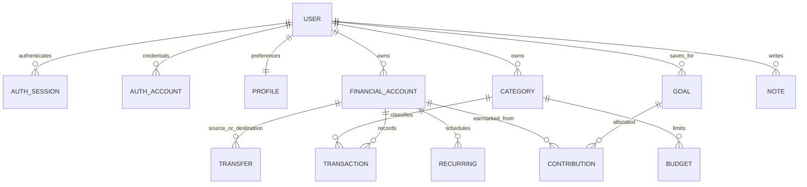

# Mizan Finance | ميزان

A bilingual personal finance application built with Next.js, TypeScript, Tailwind CSS, Drizzle ORM and Better Auth. Arabic/RTL is the default, with English/LTR, light/dark themes and ILS/USD/EUR support.

Use the **English / العربية** button in the page header to switch languages. The preference persists across navigation and reloads; a new browser uses your saved account language after signing in. Select English before opening the demo to create English sample accounts, goals and notes. User-entered financial content is never automatically translated.

Financial records are persisted on the server. `localStorage` is used only for presentation preferences. This application does not connect to banks, execute payments or provide investment advice.

## Run locally

Requirements: Node.js 22.12 or newer (Node.js 24 is used in CI), npm, and a modern browser. No external service is required for local development.

```sh
npm ci
npm run db:migrate
npm run dev
```

Open [http://localhost:3000](http://localhost:3000). Register a new account and complete onboarding, or choose **Try the platform / جرّب المنصة** for a separate seeded demo workspace. Each demo visitor receives an isolated database-backed session. Demo sessions expire after 24 hours; run `npx tsx scripts/cleanup-demos.ts` periodically to remove expired demo rows.

Without `DATABASE_URL`, the app uses **PGlite**, a local PostgreSQL engine. Its files are persisted under `data/pglite/`, which is ignored by Git. Reloading the page, signing out and signing in do not clear real account data. Run only one application process against a PGlite directory, and stop the development server before running migration or seed commands against that same directory. The demo is for exploration; do not enter personal information into it.

Copy `.env.example` to `.env` when configuring external services; both Next.js and the CLI scripts read it. Next.js also supports `.env.local`, but shell variables or `.env` must be used for the CLI migration/seed commands. The checked-in example contains placeholders only. Dependency versions are pinned by `package-lock.json`; use `npm ci` for reproducible installs.

## Commands

| Command | Purpose |
| --- | --- |
| `npm run dev` | Development server on port 3000 |
| `npm run build` | Optimized production build |
| `npm start` | Run the production build |
| `npm run lint` | ESLint, TypeScript and React rules |
| `npm run typecheck` | TypeScript check without emitting files |
| `npm test` | Money/calendar unit tests and database integration tests |
| `npm run test:e2e` | Playwright API and browser workflows |
| `npm run db:migrate` | Apply checked-in SQL migrations |
| `npm run db:seed` | Create a dedicated sample-data workspace |

For browser tests, install the browser once:

```sh
npx playwright install chromium
npm run test:e2e
```

Playwright starts its own development server on port 3100 and uses `data/e2e`. A `PLAYWRIGHT_PORT` environment variable can change the port. Unit/integration tests default to an ephemeral in-memory PGlite database and never connect to `DATABASE_URL` from a developer's environment. To test an explicitly disposable PostgreSQL database instead, set `FINANCE_TEST_DATABASE_URL` before running the integration suite.

Set `PLAYWRIGHT_USE_PRODUCTION=true` after `npm run build` to run browser checks against the production server; CI uses this mode. `node scripts/capture.mjs` captures demo-only delivery images and real dashboard previews from a running server on port 3000 (`CAPTURE_URL` overrides it).

## Data model and financial rules



- Amounts are integer minor units in the database and API: `12345` means `123.45`. Decimal text is parsed without multiplying floating point values. Arithmetic checks the safe-integer range.
- A balance is opening balance + income − expenses + incoming transfers − outgoing transfers. Balances are derived from the ledger, so editing/deleting a transaction cannot leave a stale cached balance.
- Transfers require two owned accounts with the same currency. One transfer record represents both legs within a database transaction. It is excluded from income and spending.
- ILS, USD and EUR totals are kept separate. There is no exchange-rate service or implicit currency conversion.
- Goal contributions earmark existing money. They do not create expenses or reduce total account balances. These allocations are bookkeeping, not a spending lock; later spending and transfers remain possible.
- A budget is scoped to an owner, month, category and currency; its spent amount is derived from matching expenses.
- Recurring definitions are schedules. Processing due items creates actual ledger entries and advances their next dates. A unique occurrence key prevents processing the same occurrence twice. Monthly/yearly dates clamp to the last valid day of the target month.
- CSV import validates mapped rows before committing them. Duplicate fingerprints are owner-scoped; repeated rows and repeat imports are skipped. An invalid batch is not partially saved.

## Architecture

```text
src/app/                 Next.js routes and HTTP endpoints
src/components/          Landing, authentication and finance UI
src/lib/contracts.ts     Shared API/domain interfaces
src/lib/finance.ts       Exact money and calendar calculations
src/server/schema.ts     Drizzle PostgreSQL schema
src/server/db.ts         PostgreSQL/PGlite connection and migrations
src/server/finance-service.ts  Validated, owner-scoped operations
drizzle/                 Versioned SQL migrations
scripts/                 Migration and seed entry points
tests/                   Unit, database and browser checks
```

`GET /api/finance` returns the current user's snapshot. `POST /api/finance` validates and applies an action. The acting user comes from the server session; client-supplied user IDs do not grant access. `GET /api/export?format=csv|json` exports only that user's data. Account deletion requires the literal confirmation `DELETE` and removes that owner's data and sessions.

Better Auth handles password hashing and real-account sessions. The demo uses a distinct, expiring session mechanism and separate user-owned rows. Secrets, database files, logs and browser test traces are excluded from Git. Cross-origin mutations are rejected. Ownership checks are repeated for referenced accounts, categories, goals and records rather than trusting a submitted ID.

## Production deployment

Deploy to a Node.js host that supports Next.js server rendering and outbound PostgreSQL connections. Configure a private PostgreSQL database, TLS as required by your provider, persistent backups, and the variables from `.env.example`.

At minimum, configure:

| Variable | Meaning |
| --- | --- |
| `DATABASE_URL` | PostgreSQL connection string; required for production |
| `BETTER_AUTH_SECRET` | Long random secret; generate outside source control |
| `BETTER_AUTH_URL` | Canonical HTTPS application URL |
| SMTP variables in `.env.example` | Required to send password-reset email |
| `PGLITE_DATA_DIR` | Optional local data location; development/test only |

```sh
npm ci
npm run db:migrate
npm run build
npm start
```

The application also applies pending migrations when it opens the database. PostgreSQL migration execution uses an advisory lock so application processes do not apply the same migration simultaneously. Deploy the `drizzle` directory with the application. For a single-process local production preview only, `ALLOW_LOCAL_DB=true` permits PGlite with `npm start`; do not use this mode for multi-instance or serverless production.

No deployment provider or email account is provisioned automatically. Password-reset delivery requires an SMTP service. Without that configuration, the interface must report the missing setup rather than claim to have sent mail.

## Quality checks

Verified locally on 6 November 2026: lint and TypeScript passed; 34 unit/database tests and 9 production-server browser tests passed. `npm audit` reported zero vulnerabilities after the scoped lint-tool dependency fix. See the repository Actions tab for the result against each pushed commit.

### Screenshots

These are captures of the running application with isolated sample data, not design mockups.

| Landing | Dashboard | Phone |
| --- | --- | --- |
| [Arabic](docs/screenshots/landing-desktop.png) · [English](docs/screenshots/landing-english-desktop.png) | [Arabic](docs/screenshots/dashboard-desktop.png) · [English](docs/screenshots/dashboard-english.png) · [Dark](docs/screenshots/dashboard-dark.png) | [Arabic dashboard](docs/screenshots/dashboard-mobile.png) · [English dashboard](docs/screenshots/dashboard-english-mobile.png) · [English landing](docs/screenshots/landing-english-mobile.png) |

The GitHub Actions workflow runs lint, type checking, money/calendar tests, PGlite integration tests, a production build and Playwright workflows. A separate job runs the integration suite against PostgreSQL 17. Browser failures upload diagnostic artifacts for seven days.

Tests exercise exact balances, transfer conservation, transaction update/deletion, budget derivation, goal allocation, input validation, ownership isolation, atomic import and duplicate prevention, due schedules, authentication, CSV/JSON export, session persistence, demo isolation and cross-origin request rejection. Test success and CI status are reported from actual executions in the delivery message, not assumed from the presence of this workflow.

## Current boundaries

- Accounts are manual; no bank integration, payment processing, exchange-rate conversion or investment advice is presented as available.
- The recurring processor is invoked explicitly in the app. It is not an unattended background scheduler; a production scheduler can invoke the same owner-scoped service through a separately authenticated integration.
- CSV deduplication is based on row content. Two genuinely identical purchases may be considered duplicates on import; enter one manually if both are intentional.
- A printed report uses the browser's print dialog and its **Save as PDF** feature; no external PDF-generation service is required.
- PGlite is a practical local database, not the supported multi-instance production configuration.
- Email verification, MFA, bank-grade certifications and third-party security audits are not claimed.

## Official implementation references

The scoped `minimatch` override upgrades only the TypeScript ESLint dependency to 11.0.1, addressing GHSA-g3hv-75wg-m249. It has been validated by running lint; remove the override when the upstream dependency range incorporates the fix.

- [Next.js installation and supported runtime](https://nextjs.org/docs/app/getting-started/installation)
- [Better Auth Drizzle adapter](https://better-auth.com/docs/adapters/drizzle)
- [Drizzle with PGlite](https://orm.drizzle.team/docs/get-started/pglite-new)
- [Tailwind CSS with Next.js](https://tailwindcss.com/docs/installation/framework-guides/nextjs)
