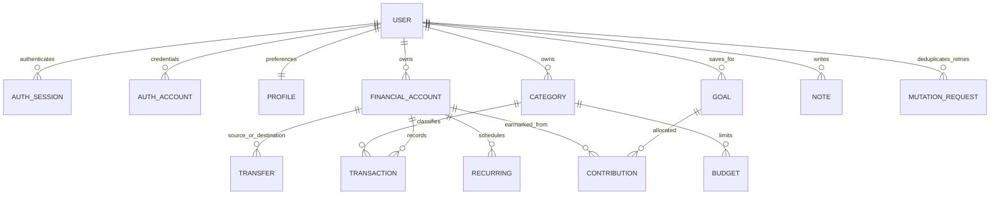

# Mizan Finance | ميزان

A four-language personal finance application built with Next.js, TypeScript, Tailwind CSS, Drizzle ORM and Better Auth. Arabic is the default; Arabic and Hebrew use RTL, while English and German use LTR. All four languages support light/dark themes and ILS/USD/EUR.

Start with this README, then [service configuration](docs/API_SETUP.md), [operations, backups and recovery](docs/OPERATIONS.md), [brand assets and design tokens](docs/BRAND.md), and [delivery evidence](docs/DELIVERY_REPORT.md). [PROJECT_STATE.md](PROJECT_STATE.md) records the acceptance map and remaining provider checks. The source is prepared for configuration and live verification; no public deployment or real provider inbox has been verified on the owner's behalf.

Use the native **Language** selector in the page header or profile settings to choose **العربية**, **English**, **עברית** or **Deutsch**. The presentation preference persists across navigation and reloads. Save your profile settings to retain the account language on the server; a browser without a local language preference restores it after sign-in. Select a language before opening a new demo to create sample accounts, goals and notes in that language. Existing user-entered names, descriptions, notes and financial content are preserved and never automatically translated.

The visual system uses warm ivory surfaces, navy structure and emerald actions. Fonts are locally bundled: Noto Sans Arabic for Arabic, Noto Sans Hebrew for Hebrew, and DM Sans for English and German. Financial figures use tabular numerals, primary buttons and form fields use a consistent 44px minimum control height, and light/dark themes share explicit color and focus tokens.

Amounts, dates and built-in category labels follow the selected locale. German amount fields accept ungrouped decimal commas such as `123,45`, as well as the canonical decimal-point form `123.45`; edit fields display the comma form. Do not enter thousands separators: ambiguous grouped values such as `1.234,56`, `1,234.56` or `1 234,56` are rejected instead of being guessed. The database and API continue to use exact integer minor units.

For existing installations, `npm run db:migrate` applies [`0003_profile_locales.sql`](drizzle/0003_profile_locales.sql), which expands the saved-language constraint to `ar`, `en`, `he` and `de` without changing existing choices or financial data. Interface validation and API errors are localized; password-reset email templates use the saved account language. Actual email delivery still requires the SMTP configuration described below.

Financial records are persisted on the server. `localStorage` is used only for presentation preferences. This application does not connect to banks, execute payments or provide investment advice.

## Test a decision | اختبر قرارك

Open **Test a decision** in the workspace navigation (on mobile, use **More**). Compare a one-time purchase and alternative daily spending over 30, 60 or 90 days. The screen uses your own as-of ledger, future recorded entries and active recurring schedules; it shows both paths, the lowest balance/date, the first reserve breach and a conditional purchase ceiling. Enter additional daily spending explicitly, including zero when appropriate. You can protect existing goal allocations and add a separate cash buffer without counting either as an expense.

The screen is available in all four languages and includes an interactive chart, exact daily table, event provenance and **How was this calculated?**. A possible overlap between a manual entry and a recurring schedule blocks results until reviewed. Currency totals stay separate. These are conditional daily closing balances for all accounts of one currency, not a guarantee of intraday or individual-account funds. Assumptions are temporary and reset on reload, currency changes or refreshed financial data; no transactions or schedules are changed. No external setup or migration is needed for the simulator itself.

See the [five-competitor research and three-candidate decision](docs/simulator-research.md) and the [equations, independently solved example and limits](docs/simulator-model.md).

## Monthly savings capacity | حاسبة الادخار

Open **Savings capacity** at `/app/savings` (on mobile, open **More**). Enter monthly take-home income, add itemized monthly expenses, and optionally keep a separate cash reserve. The result updates as you edit: maximum saving is `max(income − expenses, 0)`; saving after the reserve is `max(income − expenses − reserve, 0)`. A shortfall is shown separately, and a zero income has no percentage rate. For example, income of 8,000 and expenses of 5,000 leaves 3,000 (37.5%); keeping a reserve of 500 leaves 2,500 available to save.

**Use recorded month** explicitly replaces the income and expense inputs with the selected calendar month's recorded transactions in one currency. Expenses are grouped by category, including any future-dated entries already recorded in that month. Transfers, goal allocations, budgets, opening balances and unposted recurring schedules are not added. Review the imported figures for missing costs and income, especially during an unfinished month. Enter yearly or irregular costs as your own monthly provision if you want to allow for them.

These are conditional estimates, not a guarantee that all expenses have been included or that income will repeat. Calculator assumptions are temporary and reset on reload, currency changes or refreshed financial data; they do not post ledger transactions and are not written to browser storage. Actual recorded financial data remains in the database. No additional service, dependency or migration is required. See the [calculation model and independently solved examples](docs/savings-capacity-model.md).

Real calculator captures: [Arabic](docs/screenshots/savings-ar-desktop.png), [English](docs/screenshots/savings-en-desktop.png), [Hebrew](docs/screenshots/savings-he-desktop.png), [German](docs/screenshots/savings-de-desktop.png), [phone](docs/screenshots/savings-ar-mobile.png), and [dark mode](docs/screenshots/savings-en-dark.png). Run `node scripts/capture-savings.mjs` against a running local preview to reproduce them with isolated demo sessions and the 8,000/5,000/500 example above.

## Run locally

Requirements: Node.js 22.12 or newer (Node.js 24 is used in CI), npm, and a modern browser. No external service is required for local development.

```sh
npm ci
npm run check:config
npm run db:migrate
npm run dev
```

Open [http://localhost:3000](http://localhost:3000). Register a new account and complete onboarding, or choose **Try the platform / جرّب المنصة** for a separate seeded demo workspace. Each demo visitor receives an isolated database-backed session. Demo sessions expire after 24 hours; run `npx tsx scripts/cleanup-demos.ts` periodically to remove expired demo rows.

Without `DATABASE_URL`, the app uses **PGlite**, a local PostgreSQL engine. Its files are persisted under `data/pglite/`, which is ignored by Git. Reloading the page, signing out and signing in do not clear real account data. Run only one application process against a PGlite directory, and stop the development server before running migration or seed commands against that same directory. The demo is for exploration; do not enter personal information into it.

Copy `.env.example` to `.env` when configuring external services; both Next.js and the CLI scripts read it. Next.js also supports `.env.local`, but shell variables or `.env` must be used for the CLI migration/seed commands. The checked-in example contains placeholders only. Dependency versions are pinned by `package-lock.json`; use `npm ci` for reproducible installs.

## Commands

| Command | Purpose |
| --- | --- |
| `npm run dev` | Development server on port 3000 |
| `npm run build` | Optimized production build |
| `npm start` | Run the production build |
| `npm run lint` | ESLint, TypeScript and React rules |
| `npm run typecheck` | TypeScript check without emitting files |
| `npm test` | Money/calendar unit tests and database integration tests |
| `npm run test:e2e` | Playwright API and browser workflows |
| `npm run db:migrate` | Apply checked-in SQL migrations |
| `npm run db:seed` | Create a dedicated sample-data workspace |
| `npm run check:config` | Validate settings without printing values; optional `--production`, `--database`, `--smtp` checks |
| `npm run check:persistence` | Production stop/start check with an isolated local database and demo |
| `npm run demo:cleanup` | Remove expired demo data from the configured database |
| `npm run brand:generate` | Regenerate the ready-to-use SVG/PNG identity files |
| `npm run review:delivery` | Local demo-only browser, accessibility, layout and screenshot review |

For browser tests, install the browser once:

```sh
npx playwright install chromium
npm run test:e2e
```

Playwright starts its own development server on port 3100 and uses `data/e2e`. A `PLAYWRIGHT_PORT` environment variable can change the port. Unit/integration tests default to an ephemeral in-memory PGlite database and never connect to `DATABASE_URL` from a developer's environment. To test an explicitly disposable PostgreSQL database instead, set `FINANCE_TEST_DATABASE_URL` before running the integration suite.

Set `PLAYWRIGHT_USE_PRODUCTION=true` after `npm run build` to run browser checks against the production server; CI uses this mode. `node scripts/capture.mjs` captures demo-only delivery images and real dashboard previews from a running server on port 3000 (`CAPTURE_URL` overrides it).

To regenerate all four languages' real dashboard previews and page captures, first run the production preview with the database configuration described below. In another terminal, run:

```sh
node scripts/capture-locales.mjs previews
```

This writes desktop/mobile and light/dark dashboard previews under `public/`, plus dashboard screenshots under `docs/screenshots/`. Stop and restart the production preview with `npm start` so Next.js indexes the newly generated public files, then capture the landing pages and simulator:

```sh
node scripts/capture-locales.mjs pages
```

Both phases use isolated demo sessions. `CAPTURE_URL` can select another local preview URL; the default is `http://localhost:3000`. Install Playwright Chromium before running either phase.

## Data model and financial rules



- Amounts are integer minor units in the database and API: `12345` means `123.45`. Decimal text is parsed without multiplying floating point values. Arithmetic checks the safe-integer range.
- A balance is opening balance + income − expenses + incoming transfers − outgoing transfers. Balances are derived from the ledger, so editing/deleting a transaction cannot leave a stale cached balance.
- Transfers require two owned accounts with the same currency. One transfer record represents both legs within a database transaction. It is excluded from income and spending.
- ILS, USD and EUR totals are kept separate. There is no exchange-rate service or implicit currency conversion.
- Goal contributions earmark existing money. They do not create expenses or reduce total account balances. These allocations are bookkeeping, not a spending lock; later spending and transfers remain possible.
- A budget is scoped to an owner, month, category and currency; its spent amount is derived from matching expenses.
- Recurring definitions are schedules. Processing due items creates actual ledger entries and advances their next dates. A unique occurrence key prevents processing the same occurrence twice. Monthly/yearly dates clamp to the last valid day of the target month.
- CSV import validates mapped rows before committing them. Explicit account/category IDs take precedence over names; ambiguous names require correction before saving. Duplicate fingerprints are owner-scoped; repeated rows and repeat imports are skipped. An invalid batch is not partially saved.
- Browser writes carry an owner-scoped retry ID. The database records its payload hash in the same transaction as the operation; a lost response can be retried without repeating the effect, including after an intervening session error. Keep the form unchanged when retrying. IDs stay in temporary memory until a response is confirmed; after closing/reloading a failed form, inspect the ledger before entering the operation again. The `X-Mizan-Workspace` check also prevents a stale tab writing into a different account after sign-in changes.
- CSV exports protect spreadsheet formula-like text. An explicit per-row `noteEncoding` marker preserves the original note on reimport without treating an ordinary apostrophe in external files as an escape. Keep this column when round-tripping a Mizan export.

## Architecture

```text
src/app/                 Next.js routes and HTTP endpoints
src/components/          Landing, authentication and finance UI
src/lib/contracts.ts     Shared API/domain interfaces
src/lib/finance.ts       Exact money and calendar calculations
src/lib/i18n.ts          Locale, direction, formatting and message helpers
src/lib/locales/         Hebrew/German message catalogs with stable keys
src/lib/simulator.ts     Pure daily scenario engine, exact minor units
src/lib/savings-capacity.ts  Pure monthly savings calculation and ledger grouping
src/components/finance/scenario-simulator.tsx  Four-language decision sandbox
src/server/schema.ts     Drizzle PostgreSQL schema
src/server/db.ts         PostgreSQL/PGlite connection and migrations
src/server/finance-service.ts  Validated, owner-scoped operations
drizzle/                 Versioned SQL migrations
scripts/                 Migration and seed entry points
tests/                   Unit, database and browser checks
```

`GET /api/finance` returns the current user's snapshot. `POST /api/finance` validates and applies an action. The acting user comes from the server session; client-supplied user IDs do not grant access. `GET /api/export?format=csv|json` exports only that user's data. Account deletion requires the literal confirmation `DELETE` and removes that owner's data and sessions.

Better Auth handles password hashing and real-account sessions. The demo uses a distinct, expiring session mechanism and separate user-owned rows. Secrets, database files, logs and browser test traces are excluded from Git. Cross-origin mutations are rejected. Ownership checks are repeated for referenced accounts, categories, goals and records rather than trusting a submitted ID.

## Production deployment

Deploy to a Node.js host that supports Next.js server rendering and outbound PostgreSQL connections. Configure a private PostgreSQL database, TLS as required by your provider, persistent backups, and the variables from `.env.example`.

At minimum, configure:

| Variable | Meaning |
| --- | --- |
| `DATABASE_URL` | PostgreSQL connection string; required for production |
| `BETTER_AUTH_SECRET` | Long random secret; generate outside source control |
| `BETTER_AUTH_URL` | Canonical HTTPS application URL |
| SMTP variables in `.env.example` | Required to send password-reset email |
| `PGLITE_DATA_DIR` | Optional local data location; development/test only |

```sh
npm ci
npm run check:config -- --production --database
npm run db:migrate
npm run build
npm start
```

The application also applies pending migrations when it opens the database. PostgreSQL migration execution uses an advisory lock so application processes do not apply the same migration simultaneously. Deploy the `drizzle` directory with the application. For a single-process local production preview only, `ALLOW_LOCAL_DB=true` permits PGlite with `npm start`; do not use this mode for multi-instance or serverless production.

No deployment provider or email account is provisioned automatically. Password-reset delivery requires `SMTP_URL` and `MAIL_FROM`. The subject and message template follow the saved profile language. The SMTP integration is implemented, but real sender authorization and inbox arrival require your provider configuration and live check. Without SMTP configuration, the interface reports that recovery is unavailable rather than claiming to have sent mail.

The SMTP adapter enforces remote TLS, finite connection/command timeouts and recipient acceptance. Delivery failures return an unavailable response; messages are not automatically retried. `npm run check:config -- --smtp` checks connection/authentication without sending mail. Actual sender authorization and inbox arrival require the [documented owner-controlled live check](docs/API_SETUP.md). Local protocol tests exercise a real SMTP connection and password reset flow, but are not evidence of a production mail account.

`GET /api/health` checks liveness. `GET /api/health?check=ready` returns only `ready`/`unavailable` after checking the database and core configuration. Its five-second deadline bounds asynchronous waits; first-time synchronous PGlite file creation can delay the local event loop, so run `db:migrate` before the first local start. It does not certify SMTP, backups or hosted infrastructure. Set `BETTER_AUTH_URL` before building public metadata; changing it requires rebuilding. Authentication/private workspace routes are marked `noindex` independently of session authorization.

## Quality checks

Verified on 11–12 November 2026 from a fresh `npm ci`: lint, TypeScript, **264 unit/database/integration tests in 17 files**, and the production build passed. A real stop/start test preserved the session, exact balance, ledger and retry identity. All **23 production browser tests** and the **58-sample visual/accessibility audit** passed. Both GitHub CI jobs, including PostgreSQL 17, also passed for the implementation commit. [DELIVERY_REPORT](docs/DELIVERY_REPORT.md) links the observed run and records the scope and limits of the checks. `npm audit --audit-level=high` reported **zero known vulnerabilities** at the time of verification.

The checks exercise real registration/onboarding, four languages, both themes, exact financial calculations, owner isolation, failed network writes, expired sessions, CSV round trips, recurring duplicate prevention, purchase scenarios and monthly savings. SMTP tests use an actual local protocol peer and the Better Auth recovery handler; they do not send real mail. Hosted PostgreSQL, HTTPS ingress, real sender delivery and provider backup restoration still require the owner's live checks.

### Screenshots

These are captures of the running application with isolated sample data, not design mockups. The final delivery captures are [Arabic landing](docs/screenshots/delivery-landing-ar-1440-light.png), [English dark dashboard](docs/screenshots/delivery-dashboard-en-1440-dark.png), [Hebrew phone](docs/screenshots/delivery-dashboard-he-390-light.png), and [German phone savings](docs/screenshots/delivery-savings-de-320-dark.png); the earlier feature captures below show the independently tested calculators.

| Landing | Dashboard | Phone |
| --- | --- | --- |
| [Arabic](docs/screenshots/landing-desktop.png) · [English](docs/screenshots/landing-english-desktop.png) | [Arabic](docs/screenshots/dashboard-desktop.png) · [English](docs/screenshots/dashboard-english.png) · [Dark](docs/screenshots/dashboard-dark.png) | [Arabic dashboard](docs/screenshots/dashboard-mobile.png) · [English dashboard](docs/screenshots/dashboard-english-mobile.png) · [English landing](docs/screenshots/landing-english-mobile.png) |

Purchase simulator: [Arabic](docs/screenshots/simulator-arabic.png) · [English](docs/screenshots/simulator-english.png) · [Dark](docs/screenshots/simulator-dark.png) · [Phone](docs/screenshots/simulator-mobile.png). Run `node scripts/capture-simulator.mjs` against the local preview to reproduce these isolated-demo captures.

The two-phase `capture-locales.mjs` workflow also writes these Hebrew and German captures:

| Language | Landing | Dashboard | Simulator |
| --- | --- | --- | --- |
| עברית · RTL | [Desktop](docs/screenshots/landing-hebrew-desktop.png) · [Phone](docs/screenshots/landing-hebrew-mobile.png) | [Desktop](docs/screenshots/dashboard-hebrew.png) · [Phone](docs/screenshots/dashboard-hebrew-mobile.png) | [Desktop](docs/screenshots/simulator-hebrew.png) · [Phone](docs/screenshots/simulator-hebrew-mobile.png) |
| Deutsch · LTR | [Desktop](docs/screenshots/landing-german-desktop.png) · [Phone](docs/screenshots/landing-german-mobile.png) | [Desktop](docs/screenshots/dashboard-german.png) · [Phone](docs/screenshots/dashboard-german-mobile.png) | [Desktop](docs/screenshots/simulator-german.png) · [Phone](docs/screenshots/simulator-german-mobile.png) |

The GitHub Actions workflow runs dependency audit, configuration checks, lint, type checking, money/calendar tests, PGlite integration tests, a production build, actual stop/start persistence verification and Playwright workflows including accessibility checks. A separate job runs the integration suite against PostgreSQL 17. Browser failures upload diagnostic artifacts for seven days.

Tests exercise exact balances, transfer conservation, transaction update/deletion, budget derivation, goal allocation, input validation, ownership isolation, atomic import and duplicate prevention, due schedules, authentication, CSV/JSON export, session persistence, demo isolation and cross-origin request rejection. Test success and CI status are reported from actual executions in the delivery message, not assumed from the presence of this workflow.

## Current boundaries

- Accounts are manual; no bank integration, payment processing, exchange-rate conversion or investment advice is presented as available.
- The recurring processor is invoked explicitly in the app. It is not an unattended background scheduler; a production scheduler can invoke the same owner-scoped service through a separately authenticated integration.
- CSV deduplication is based on row content. Two genuinely identical purchases may be considered duplicates on import; enter one manually if both are intentional.
- A printed report uses the browser's print dialog and its **Save as PDF** feature; no external PDF-generation service is required.
- PGlite is a practical local database, not the supported multi-instance production configuration.
- Email verification, MFA, bank-grade certifications and third-party security audits are not claimed.

## Official implementation references

The scoped `minimatch` override upgrades only the TypeScript ESLint dependency to 11.0.1, addressing GHSA-g3hv-75wg-m249. It has been validated by running lint; remove the override when the upstream dependency range incorporates the fix.

- [Next.js installation and supported runtime](https://nextjs.org/docs/app/getting-started/installation)
- [Better Auth Drizzle adapter](https://better-auth.com/docs/adapters/drizzle)
- [Drizzle with PGlite](https://orm.drizzle.team/docs/get-started/pglite-new)
- [Tailwind CSS with Next.js](https://tailwindcss.com/docs/installation/framework-guides/nextjs)
